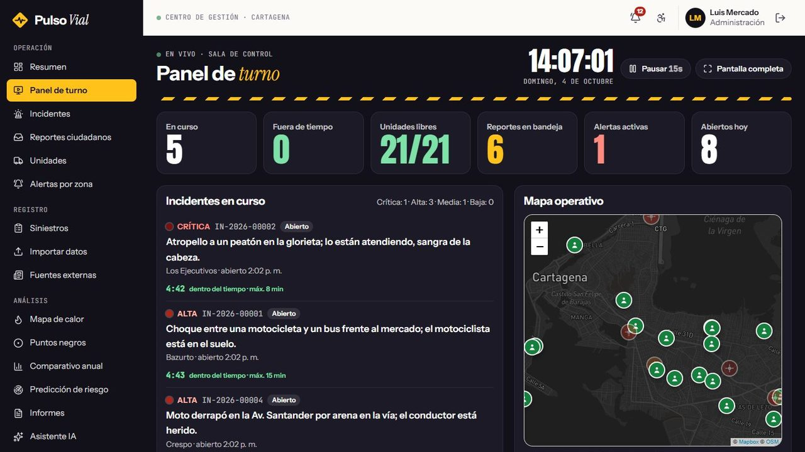
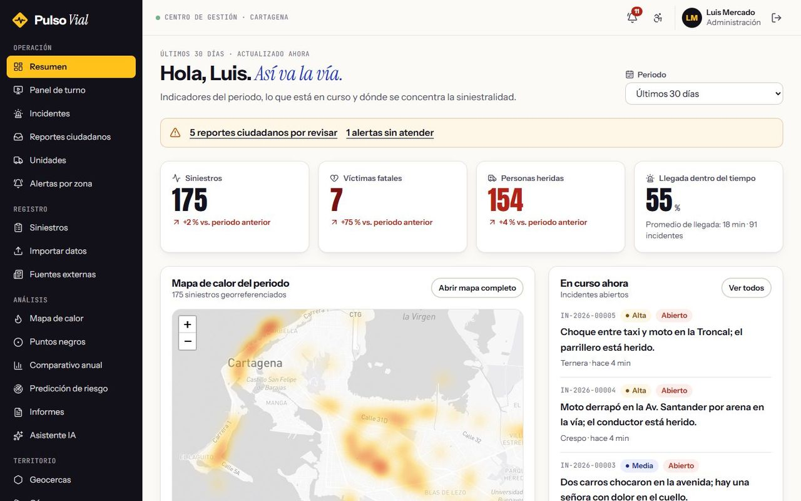
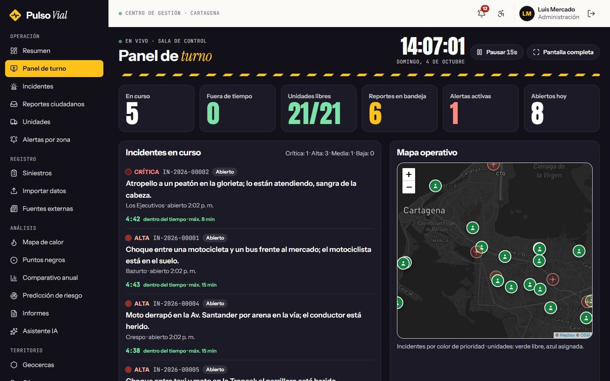
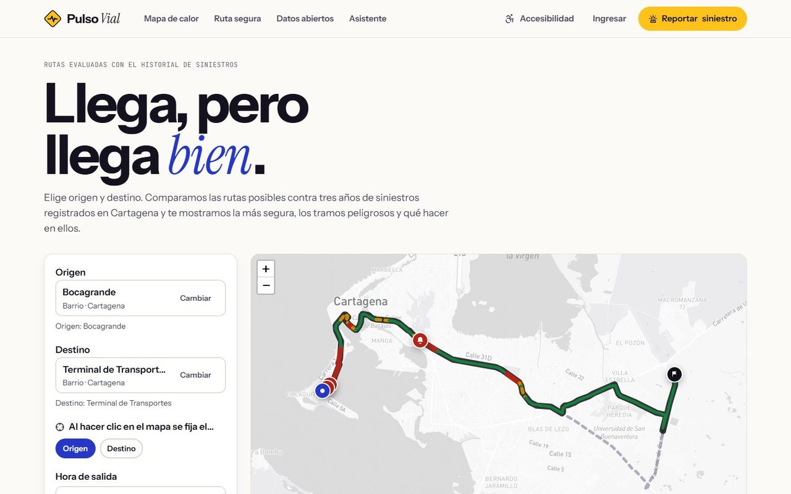
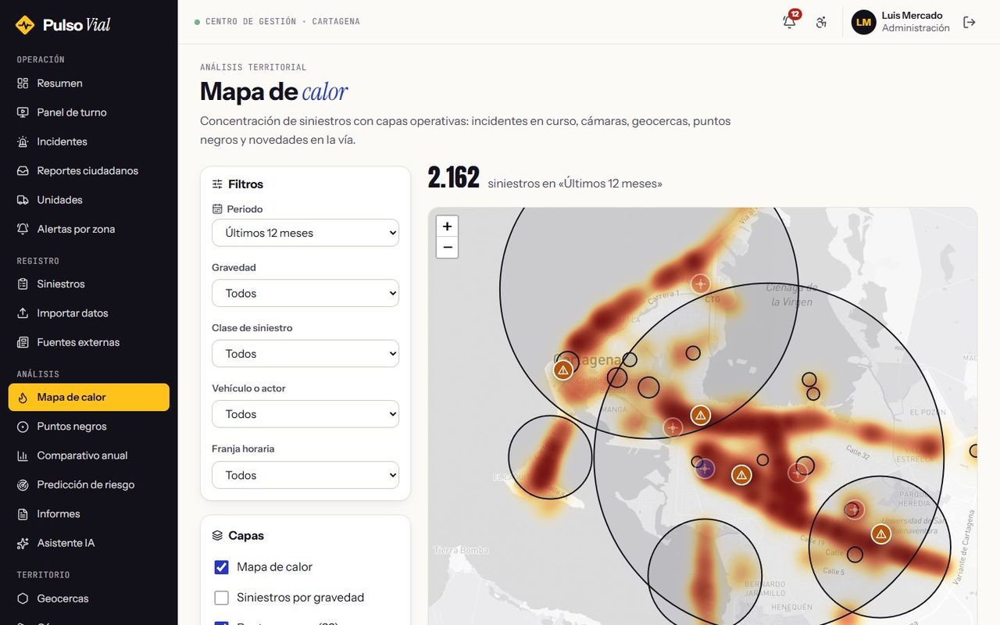
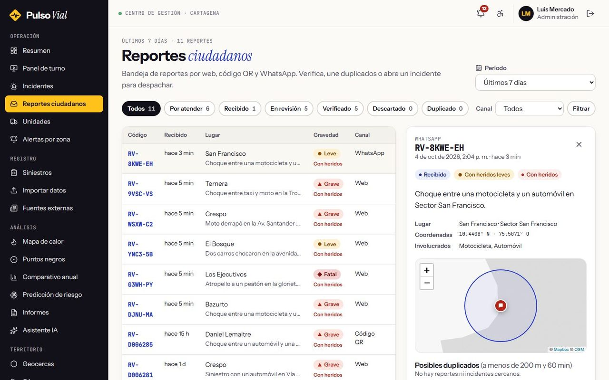
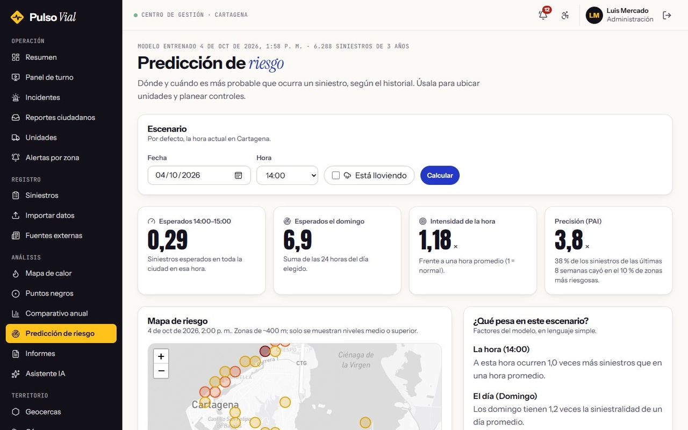
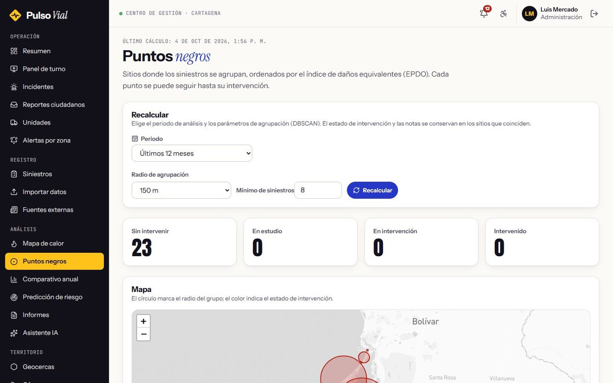
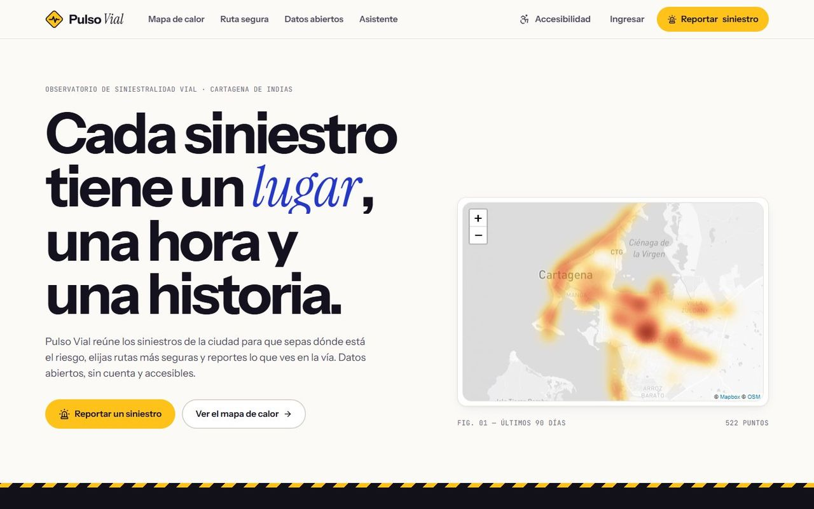
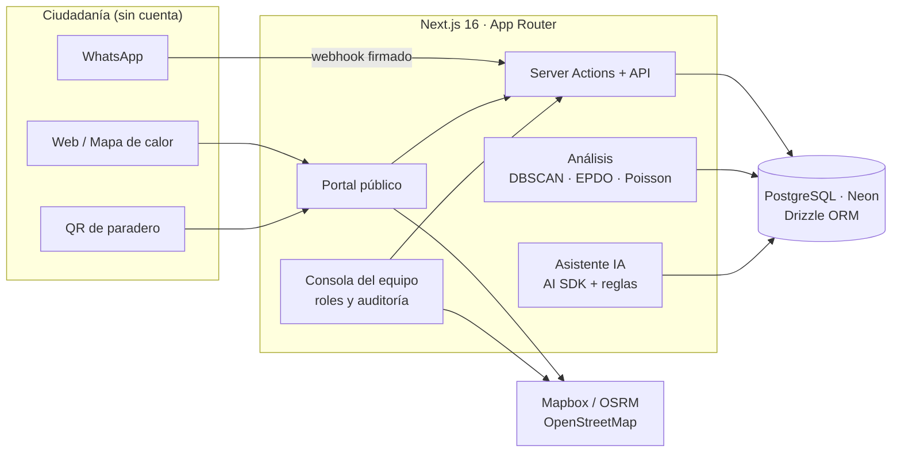

# 🚦 Pulso Vial · Siniestralidad vial de Cartagena

**Observatorio y centro de gestión de siniestros viales** — mapa de calor, ruta segura, reportes ciudadanos por QR y WhatsApp, despacho de incidentes y predicción de riesgo.

> 🔒 **Repositorio de presentación.** El código fuente es privado. Aquí encontrarás la descripción, la arquitectura y capturas del sistema. Si quieres conocer el código para un proceso de selección, [escríbeme](mailto:luisda3329@hotmail.com).
>
> Iniciativa independiente: no representa a ninguna entidad oficial.

---

## 📌 Qué es

Plataforma full-stack para gestionar la siniestralidad vial de Cartagena de punta a punta:

- **La ciudadanía** consulta el mapa de calor, compara rutas según su riesgo y reporta siniestros sin crear cuenta (web, código QR del paradero o WhatsApp) con un código de seguimiento.
- **El equipo de operación** recibe esos reportes en una bandeja, abre incidentes, despacha la unidad más cercana y mide el tiempo de llegada.
- **El equipo de análisis** detecta puntos negros, compara años y predice dónde y cuándo es más probable el próximo siniestro.

Es la reescritura completa de una versión anterior (React + FastAPI) como una sola aplicación Next.js, migrando el histórico sin tocar las tablas originales.

## ✨ Funcionalidades

- 🧭 **Ruta segura:** compara alternativas de Mapbox/OSRM y puntúa cada tramo de 100 m según los siniestros cercanos, su gravedad y la hora del viaje.
- 📲 **Reportes ciudadanos** por web, QR de paradero y WhatsApp (webhook con firma verificada), con seguimiento público y detección de duplicados.
- 🚑 **Gestión de incidentes** de la apertura al cierre: unidad más cercana, cronómetro contra el tiempo máximo de llegada y panel de turno en vivo para la sala de control.
- 📍 **Puntos negros** con DBSCAN e índice EPDO; **predicción de riesgo** con un modelo de Poisson explicable, validado con PAI (3,8 veces mejor que el azar).
- 🗓️ **Filtro de tiempo común** en todos los módulos (hoy, 7/30/90 días, años, «hace un año», rangos exactos), compartible por URL.
- 📥 Importación CSV/Excel, exportación, datos abiertos y lectura automática de noticias.
- 🤖 **Asistente IA** con herramientas sobre la base de datos (AI SDK) y modo de respaldo por reglas.
- 🔐 Roles (administración, supervisión, operación, análisis), auditoría y **WCAG 2.2 AA** verificado con axe.

## 🖼️ Capturas

| | |
|---|---|
|    **Consola:** indicadores del periodo, mapa de calor e incidentes en curso |    **Panel de turno** en vivo para la sala de control |
|    **Ruta segura** con tramos coloreados por riesgo |    **Mapa de calor** con capas de puntos negros, cámaras e incidentes |
|    **Bandeja de reportes** con detección de duplicados |    **Predicción de riesgo** por hora y zona |
|    **Puntos negros** detectados con DBSCAN |    **Portada pública** con las cifras del año |

## 🏗️ Arquitectura

## 🛠️ Stack

---

Hecho por **[Luis Mercado](https://github.com/luismercado29)** · Diseño y desarrollo full-stack · 2026

© 2026 Luis Mercado. Todos los derechos reservados.

